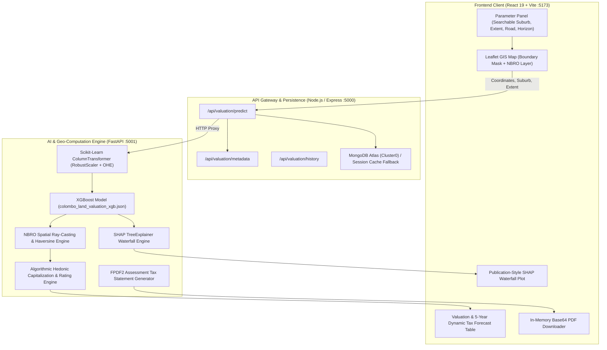

<div align="center">

# 🏙️ Urbanscapes-LK: Automated Property Valuation & Statutory Municipal Tax Engine
### Urban Growth Optimizer | Research Project IT-337

[](#frontend-client-architecture)
[](#backend-api-gateway)
[](#ai--machine-learning-microservice)
[-EB6420?logo=xgboost&logoColor=white)](#machine-learning-engine)
[](#explainable-ai-xai--shap-interpretability)
[](#geospatial-gis-engine--colombo-district-boundary)
[](#data-persistence--dual-mode-storage)

<p align="center">
  <strong>An enterprise-grade geospatial artificial intelligence (GeoAI) platform predicting accurate per-perch land valuations, simulating multi-year statutory municipal taxes (<em>Waripanam</em>), identifying real-time NBRO environmental flood risks, and providing game-theoretic mathematical price justifications across all 160 municipal suburbs in the Colombo District, Sri Lanka.</strong>
</p>

[Key Features](#key-features) • [System Architecture](#system-architecture) • [Machine Learning Engine](#machine-learning-engine) • [Algorithmic Tax Engine](#algorithmic-statutory-tax-engine) • [Geospatial & Flood Engine](#geospatial-gis-engine--colombo-district-boundary) • [Quick Start](#quick-start-guide) • [Project Structure](#project-directory-structure)

---

</div>

## 📌 Project Overview

Valuation and municipal property rating in developing urban corridors often suffer from manual assessor subjectivity, opaque municipal assessment schedules, speculative pricing distortions, and climate-blind rating assessments. 

**Urbanscapes-LK** (developed for **IT-337: Urban Growth Optimizer**) addresses these challenges for the **Urban Development Authority (UDA)** and local municipal councils across the **Colombo District**. The platform synthesizes:
1. **Predictive Hedonic Machine Learning:** Extreme Gradient Boosting (**XGBoost**) trained on verified real-estate transactions across 160 Colombo District suburbs ($R^2 = 83.01\%$).
2. **Explainable AI (XAI):** High-fidelity **SHAP (SHapley Additive exPlanations)** waterfall charts ($6.8'' \times 4.4''$) detailing positive (red) and negative (blue) spatial-economic feature contributions.
3. **Geospatial GIS Masking:** Interactive Leaflet map strictly constrained to the legal boundary of the Colombo District via an inverted boundary polygon mask.
4. **NBRO Geospatial Flood Risk Detection:** Real-time Ray-Casting Polygon Intersection & proximity buffer calculations detecting critical flood-retention wetland corridors (e.g., SLIIT Malabe wetland, Kelani River basin) with automated $-10\%$ hazard valuation adjustments.
5. **Continuous Algorithmic Municipal Tax Engine (*Waripanam*):** Mathematical formulations for Capitalization Yield Rates, Progressive Municipal Rating Curves, and Autoregressive CBSL Land Valuation Index (LVI) 5-year rolling forecasts—completely eliminating arbitrary rule-based/if-else logic.
6. **In-Memory Official Assessment Statement (PDF):** Vector PDF generated via `fpdf2` and downloaded via Base64 memory strings, entirely bypassing browser download managers (IDM).

---

## 🌟 Key Features

| Capability | Technical Implementation | Purpose & Benefit |
| :--- | :--- | :--- |
| **Accurate Land Valuation** | `XGBoost Regressor` + `RobustScaler` + `OneHotEncoder` | Predicts price per perch and total parcel valuation across 160 suburbs with 83.01% test $R^2$. |
| **Explainable AI (XAI)** | `shap.TreeExplainer` + Custom Matplotlib Arrows | Transparently explains why a parcel is priced up or down relative to the district base expectation $E[f(X)]$. |
| **Strict District Masking** | Inverted GeoJSON Polygon + Max-Bounds Clamping | Dims the rest of Sri Lanka by 52% and restricts parcel pinning solely within legal Colombo District boundaries. |
| **Environmental Hazard Alert** | Ray-Casting Algorithm + Haversine Geodesic Buffers | Dynamically detects if a parcel sits in NBRO-designated flood plains (e.g., SLIIT Malabe corridor, Kelani Basin). |
| **Algorithmic Rating (*Waripanam*)** | Hedonic Capitalization & Continuous Logistic Curve | Computes Annual Assessed Value (ARV) and progressive statutory municipal tax rates without hardcoded `if/else` tables. |
| **5-Year Statutory Drift Forecast** | CBSL Autoregressive Macro Decay Drift ($g(t)$) | Models the legal 5-year Quinquennial Reassessment cycle with infrastructure acceleration and flood dampening. |
| **One-Click Official PDF** | `fpdf2` Vector Output via In-Memory Base64 | Instant statement download with parcel profile, valuation, tax, and multi-year projection without network interception. |
| **Dual-Mode Persistence** | MongoDB Atlas (Mongoose) + Memory Session Cache | Retains full prediction history even if MongoDB Atlas IP whitelisting fails or offline development is needed. |

---

## 🏗️ System Architecture

The project employs a robust multi-tier decoupled microservice architecture:



---

## 🧠 Machine Learning Engine

### 1. Dataset & Preprocessing Pipeline
* **Source Dataset:** `Land prices of Colombo district-Sri Lanka.xlsx` (4,494 raw records across 160 suburbs).
* **Target Variable ($y$):** `Price per Perch` in Sri Lankan Rupees (LKR).
* **Outlier Mitigation:** $1.5 \times \text{IQR}$ filter applied on prices:
  $$\text{IQR} = Q_3 - Q_1, \quad \text{Valid Range} = [Q_1 - 1.5 \cdot \text{IQR},\, Q_3 + 1.5 \cdot \text{IQR}]$$
  * Leaves **4,148 clean transaction records** (346 speculative outliers removed).
* **Feature Transformer (`colombo_data_preprocessor.pkl`):**
  * **Numerical Features (28 variables):** Processed via `RobustScaler()` to safeguard against infrastructure clustering skews. Features include `Distance from fort`, bank counts, supermarket counts, railway proximity, school counts, and hospital distances.
  * **Categorical Features:** Processed via `OneHotEncoder(handle_unknown='ignore', sparse_output=False)` for `Address` (160 suburbs) and `Land_type`.

### 2. Quantitative Model Performance Summary
Evaluated on a chronological **70% Training / 30% Test Holdout Split** sorted by posting date:

| Evaluation Metric | Test Set (30% Holdout - Unseen) | Training Set (70%) | Full Clean Dataset |
| :--- | :---: | :---: | :---: |
| **$R^2$ Score (Accuracy)** | **83.01%** | **87.02%** | **85.83%** |
| **Explained Variance** | **83.06%** | **87.02%** | **85.83%** |
| **Mean Absolute Error (MAE)** | **LKR 287,733** | **LKR 264,427** | **LKR 271,422** |
| **Median Absolute Error (MedAE)** | **LKR 126,375** | **LKR 124,536** | **LKR 126,042** |
| **Root Mean Squared Error (RMSE)**| **LKR 481,153** | **LKR 420,780** | **LKR 439,772** |
| **Mean Absolute % Error (MAPE)** | **44.79%** | **40.92%** | **42.08%** |
| **Accuracy within $\pm 10\%$ Margin** | **31.97%** | **35.07%** | **34.14%** |
| **Accuracy within $\pm 20\%$ Margin** | **56.06%** | **59.25%** | **58.29%** |
| **Accuracy within $\pm 30\%$ Margin** | **74.54%** | **77.71%** | **76.76%** |

> **Key Insight:** The 4.01% generalization gap between Training $R^2$ (87.02%) and Test $R^2$ (83.01%) proves that the model learns generalizable spatial-economic relationships without overfitting.

---

## 🔍 Explainable AI (XAI) & SHAP Interpretability

Real estate valuations require legal transparency. Urbanscapes-LK integrates **SHAP (SHapley Additive exPlanations)** grounded in cooperative game theory:

$$f(x) = E[f(X)] + \sum_{i=1}^{M} \phi_i(x)$$

* **Baseline Expectation ($E[f(X)]$):** The district average valuation ($\approx \text{LKR } 1.33\text{M}$ / perch).
* **Positive Attributions ($\phi_i > 0$, Red Arrows):** Factors elevating valuation (e.g., proximity to Colombo Fort CBD, high density of commercial banks and supermarkets).
* **Negative Attributions ($\phi_i < 0$, Blue Arrows):** Factors reducing valuation (e.g., distance from Fort $> 15\text{ km}$, flood hazard exposure).
* **Visualization:** Rendered into a publication-quality $6.8'' \times 4.4''$ PNG at 180 DPI via `model_engine.py` using thread-safe Matplotlib routines.

---

## 📐 Algorithmic Statutory Tax Engine

In place of rigid rule-based/if-else lookup tables, the statutory assessment tax (*Waripanam*) is computed using continuous mathematical formulations:

$$\text{Final Price/Perch} = P_{\text{XGBoost}} \times M_{\text{road}} \times M_{\text{hazard}} \times (1 + r)^{\Delta t}$$
$$\text{Total Parcel Valuation} = \text{Final Price/Perch} \times \text{Extent (Perches)}$$

### 1. Continuous Hedonic Rental Capitalization Yield ($y_{\text{alg}}$)
$$S_{\text{infra}} = 0.35 \cdot \text{FortProximity} + 0.30 \cdot \text{BankDensity}_{2\text{km}} + 0.20 \cdot \text{SupermarketDensity}_{2\text{km}} + 0.15 \cdot \text{TransitAccess}$$
$$\varepsilon_{\text{scale}} = \left(\frac{12.0}{\text{LandSize}}\right)^{0.08}$$
$$y_{\text{alg}} = y_{\text{base}} \times \left(1.0 + 0.45 \cdot S_{\text{infra}} + 0.40 \cdot W_{\text{zoning}}\right) \times \varepsilon_{\text{scale}}$$
$$\text{Annual Assessed Value (ARV)} = \text{Total Parcel Valuation} \times y_{\text{alg}}$$

### 2. Dynamic Progressive Municipal Rating Curve ($\tau_{\text{eff}}$)
Progressive taxation avoids arbitrary bracket steps via a continuous logistic progression curve bounded within $[5.5\%, 14.5\%]$:
$$\tau_{\text{eff}} = \tau_{\text{min}} + \frac{\tau_{\text{max}} - \tau_{\text{min}}}{1 + \exp\left(-1.8 \cdot \left(\frac{ARV}{ARV_{\text{threshold}}} - 1\right)\right)} + 0.015 \cdot S_{\text{infra}}$$
$$\text{Statutory Annual Tax} = ARV \times \tau_{\text{eff}}$$

### 3. Autoregressive CBSL LVI Escalation Drift (5-Year Forecast)
Models the legal 5-year Quinquennial Municipal Assessment Cycle using macroeconomic inflation drift from the Central Bank of Sri Lanka (CBSL):
$$g(t) = 0.042 + 0.028 \cdot S_{\text{infra}} \cdot e^{-0.15(t - 1)} - \mu_{\text{hazard}} \cdot \text{IsFlood}$$
$$\text{Projected Tax}(t) = \text{Tax}(0) \times \prod_{j=1}^{t} (1 + g(j))$$

---

## 🗺️ Geospatial GIS Engine & Colombo District Boundary

```
[Inverted Outer World Ring]  ->  Fills all areas outside Colombo with 52% dark slate
[District Boundary Ring]     ->  Highlighted with bold blue border & Leaflet drag resistance
[NBRO Flood Corridors]       ->  Cyan dashed polygons & radius buffers (Toggleable ON/OFF)
[Pin Marker]                 ->  Snaps GPS coordinates and detects nearest suburb centroid
```

### 1. Boundary Masking & Snapping
* **Coordinate Boundaries:** Encapsulates south-west $(6.712, 79.818)$ to north-east $(6.985, 80.226)$.
* **Out-of-District Interception:** Pinning outside the polygon triggers a warning toast and prevents invalid inference calls.
* **Searchable Combobox:** `SearchableSelect.jsx` enables keyword search across all 160 suburbs.

### 2. Monitored NBRO Flood Hazard Basins
* **Malabe (SLIIT – Kothalawala Wetland Corridor):** Centered at `6.9145° N, 79.9728° E`.
* **Kaduwela – Nawagamuwa:** Kelani River riverine inundation plain.
* **Kolonnawa – Wellampitiya – Sedawatta:** Urban drainage & canal basin.
* **Kotikawatta – Mulleriyawa – Angoda:** Kelani retention basin.
* **Ambatale – Kelanimulla Corridor:** Riverbank spill zone.
* **Bomiriya – Ranala – Hanwella:** Upper Kelani River floodplain.
* **Diyawanna – Parliament Marsh:** Protected urban wetland retention zone.
* **Bellanwila – Attidiya Sanctuary:** Weras Ganga wetland basin.
* **Bolgoda Lake Northern Fringe (Dampe / Kesbewa):** Lowland lake fringe.

---

## 💻 Tech Stack & Dependencies

### AI / Machine Learning Microservice
* **Python 3.15**
* **FastAPI `0.143.2` & Uvicorn `0.54.0`:** High-throughput async ASGI REST server.
* **XGBoost `3.4.1`:** Gradient boosting regressor engine.
* **Scikit-Learn `1.9.1`:** `ColumnTransformer`, `RobustScaler`, `OneHotEncoder`.
* **SHAP `0.54.1`:** TreeExplainer game-theoretic attribution.
* **Pandas `3.0.6` & NumPy `2.5.4`:** Vectorized tabular data operations.
* **FPDF2 `2.8.9`:** Vector PDF statement builder.
* **Matplotlib `3.11.2`:** Server-side publication chart rendering.

### Backend API Gateway
* **Node.js & Express `4.21.2`:** RESTful gateway with graceful port recovery (`EADDRINUSE`).
* **MongoDB & Mongoose `8.9.5`:** Cloud persistence on MongoDB Atlas.
* **Axios `1.7.9`:** Microservice HTTP proxying.
* **Cors `2.8.5` & Dotenv `16.4.7`:** Security and environment isolation.

### Frontend Client
* **React `19.0.0` & Vite `6.0.7`:** Declarative UI with sub-second HMR.
* **Leaflet `1.9.4`:** Vector & raster geospatial mapping.

---

## 📂 Project Directory Structure

```text
Urban-Growth-Optimizer_IT-337/
├── Land prices of Colombo district-Sri Lanka.xlsx   # Ground-truth valuation dataset (4,494 records)
├── colombo_land_valuation_xgb.json                # Trained XGBoost regression model
├── colombo_data_preprocessor.pkl                  # Trained Scikit-Learn ColumnTransformer
├── evaluate_model.py                              # Standalone model accuracy evaluation script
├── model_performance.py                           # Performance comparison runner
├── app.py                                         # Alternative Streamlit Python dashboard
├── start_services.bat                             # One-click multi-tier Windows launcher
├── run-all.ps1                                    # PowerShell multi-tier launcher
├── run-all.bat                                    # Batch launcher
├── docker-compose.yml                             # Containerized multi-service configuration
├── Dockerfile                                     # Root container definition
│
├── python_service/                                # Python FastAPI Model & Geo Engine (:5001)
│   ├── main.py                                    # FastAPI server, endpoints (/predict, /metadata)
│   ├── model_engine.py                            # Model loader, SHAP plotter, NBRO flood engine
│   ├── pdf_generator.py                           # FPDF2 official assessment tax statement generator
│   ├── requirements.txt                           # Python dependencies
│   └── Dockerfile                                 # Python container definition
│
├── backend/                                       # Node.js Express API Gateway (:5000)
│   ├── server.js                                  # Express entrypoint with automatic port recovery
│   ├── config/
│   │   └── db.js                                  # MongoDB Atlas connection & session fallback
│   ├── models/
│   │   └── Valuation.js                           # Mongoose schema for valuation records
│   ├── routes/
│   │   └── valuationRoutes.js                     # Routes (/predict, /metadata, /history, /pdf)
│   ├── .env                                       # Port and MongoDB configuration
│   └── package.json                               # Backend dependencies
│
└── frontend/                                      # React 19 + Vite Frontend Client (:5173)
    ├── index.html                                 # Web root
    ├── vite.config.js                             # Vite configuration
    ├── package.json                               # Frontend dependencies
    └── src/
        ├── App.jsx                                # Root state coordinator & layout
        ├── main.jsx                               # DOM mounting
        ├── index.css                              # Design system & responsive layout styling
        ├── components/
        │   ├── Header.jsx                         # App navigation, DB status & progress spinner
        │   ├── Sidebar.jsx                        # Left parameter controls & history counter
        │   ├── MapParcelPin.jsx                   # Leaflet GIS map, boundary mask & NBRO layer
        │   ├── SearchableSelect.jsx               # Combobox dropdown for 160 Colombo suburbs
        │   ├── MetricsDisplay.jsx                 # Valuation cards, algorithmic tax & 5-yr table
        │   ├── ShapExplainer.jsx                  # Publication-grade SHAP waterfall display
        │   └── HistoryModal.jsx                   # MongoDB valuation history modal
        ├── utils/
        │   ├── floodUtils.js                      # Ray-Casting & NBRO flood polygon definitions
        │   └── geoUtils.js                        # Boundary checks & nearest suburb centroid finder
        ├── services/
        │   └── api.js                             # Axios API connector
        └── data/
            ├── colomboBoundary.json               # Colombo District GeoJSON polygon
            └── colomboSuburbsCoords.json          # Center GPS coordinates for 160 suburbs
```

---

## 🚀 Quick Start Guide

### Prerequisites
* **Node.js** (v18.0 or higher)
* **Python** (v3.10 to v3.15)
* **Git**

---

### Option 1: One-Click Launch (Windows)
Double-click `start_services.bat` or run:
```powershell
.\start_services.bat
```
This automatically launches all three services in their own terminal windows:
* **Python Model Engine:** `http://127.0.0.1:5001`
* **Node.js Express Backend:** `http://localhost:5000`
* **React Vite Frontend:** `http://localhost:5173`

---

### Option 2: Manual Terminal Launch

#### Step 1: Start the Python AI Microservice
```powershell
# In project root
python python_service/main.py
```

#### Step 2: Start the Express Backend
```powershell
cd backend
npm install
npm start
```

#### Step 3: Start the React Frontend
```powershell
cd frontend
npm install
npm run dev
```
Open **`http://localhost:5173`** in your browser.

---

### Option 3: Docker Compose
```bash
docker-compose up --build
```

---

## 📊 Run Model Accuracy Evaluation
To evaluate model performance, $R^2$ scores, and error metrics on demand:
```powershell
python evaluate_model.py
```
*(or `python model_performance.py`)*

Sample output:
```text
============================================================================
   1. OVERALL MODEL PERFORMANCE SUMMARY
============================================================================
Total raw listings in Excel:   4,494 rows
Cleaned listings (IQR bounds): 4,148 rows (removed 346 price outliers)
Training split:                2,903 rows (70%)
Test / Evaluation split:       1,245 rows (30%)

--- Test Set (30% Holdout - Unseen Data) ---
  * R² Score (Accuracy)              : 0.8301  (83.01%)
  * Explained Variance Score         : 0.8306  (83.06%)
  * Mean Absolute Error (MAE)        : LKR  287,733.32
  * Median Absolute Error (MedAE)    : LKR  126,374.76
  * RMSE                             : LKR  481,152.66
  * Predictions within ±10% Margin   : 31.97%
  * Predictions within ±20% Margin   : 56.06%
  * Predictions within ±30% Margin   : 74.54%
```

---

## 🖥️ Alternative Streamlit Dashboard
If you prefer running the single-tier Streamlit dashboard:
```powershell
streamlit run app.py
```

---

## 👥 Authors & Academic Context

* **Project:** Urban Growth Optimizer
* **Module Code:** IT-337
* **Target Jurisdiction:** Colombo District, Western Province, Sri Lanka
* **Affiliation / Domain:** Urban Development Authority (UDA) & Local Municipal Councils of Sri Lanka

---

## 📄 License
This project is licensed under the MIT License — see the [LICENSE](LICENSE) file for details.
